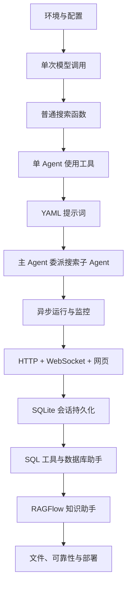

# 17：从零复现——敲代码顺序与阶段验收

[返回课程目录](README.md) · [配套函数使用手册](18-function-handbook.md)

本指南将“先写什么、后写什么”整理成可执行的学习路线。编写于 2026-11-03，适合一边阅读已有源码，一边在自己的练习目录逐步实现。

**每阶段遵循：写最少的代码 → 单独调用验证 → 解释输入输出 → 再接入上一阶段。** 不要从完整版 main_agent.py 的第一行开始照抄，它已经依赖几乎所有模块。

文中的第一版代码是教学实现，后续阶段会明确升级哪些地方。不要把不同阶段的同名函数全部追加在一个文件中；升级时替换对应旧实现。涉及真实模型、搜索、数据库和 RAG 的示例需要你自己的可用服务，本文未代你执行这些请求。

## 0. 怎么使用这份指南

1. 把现有代码作为参照；在独立目录复现，或明确记录当前正在重写哪些文件。
2. 每次只完成一个阶段，勾选验收清单。
3. 遇到不认识的调用，在 [函数手册](18-function-handbook.md) 查所属库、参数、返回值和示例。
4. 遇到原理问题，回到课程中的相应章节。
5. 不把“程序没有报错”当作功能正确的唯一证据。

待创建路径使用代码格式表示，不要求它们现在已经存在。工作区若正在删除或重建文件，以你自己的复现进度为准；本指南不会恢复那些文件。

### 最终路线



### 敲代码顺序总表

| 阶段 | 创建或修改的文件                         | 核心调用                               | 可观察成果         |
| ---- | ---------------------------------------- | -------------------------------------- | ------------------ |
| 1    | 环境、.env、.gitignore、依赖             | venv、pip、os.getenv                   | 配置能读取         |
| 2    | agent/llm.py                             | load_dotenv、init_chat_model、invoke   | 模型能回答         |
| 3    | tools/tavily_tool.py                     | TavilyClient、search                   | 程序能搜索         |
| 4    | 搜索工具、根目录演示入口                 | @tool、create_deep_agent、invoke       | 模型会选工具       |
| 5    | prompt/prompts.yml、agent/prompts.py     | safe_load、Path                        | 提示词独立管理     |
| 6    | 搜索子智能体、agent/main_agent.py        | subagents、task 委派                   | 主 Agent 能分工    |
| 7    | api/context.py、api/monitor.py、运行函数 | ContextVar、astream、asyncio.run       | 有会话编号和事件   |
| 8    | api/server.py、api/static/index.html     | FastAPI、create_task、WebSocket、fetch | 浏览器完成任务     |
| 9    | main_agent.py、server.py                 | AsyncSqliteSaver、asynccontextmanager  | 同会话可延续       |
| 10   | SQL、db_tools.py、数据库子智能体         | connect、execute、fetchall             | 精确查询业务数据   |
| 11   | rawflow 配置、RAG 工具及子智能体         | list_chats、ask、delete_sessions       | 查询内部资料       |
| 12   | 路径、文档、上传下载、重试、部署         | write_text、read_text、FileResponse    | 完整应用与错误边界 |

## 1. 环境与配置

### 1.1 建立初始目录

```text
rebuild-project/
├── .env
├── .env.example
├── .gitignore
├── requirements.txt
├── agent/
│   └── __init__.py
└── tools/
    └── __init__.py
```

空的 `__init__.py` 让初学阶段的包结构更直观。Python 也支持命名空间包，原项目并不要求所有目录都有此文件。

在新练习目录中，创建虚拟环境：

```powershell
python --version
python -m venv .venv
.\.venv\Scripts\python.exe -m pip --version
```

后续示例用 `python` 简写解释器。若没有激活环境，请替换为 `.\.venv\Scripts\python.exe`，避免装包装到一个环境、运行却使用另一个环境。

依赖版本优先参考当前项目 requirements.txt。至少先理解 `python-dotenv`、`langchain`、`langchain-openai` 的作用；搜索阶段再关注 `tavily-python`；Agent 阶段再关注 `deepagents`。不要随意把不同版本教程的依赖混装。

### 1.2 配置示例

```dotenv
OPENAI_BASE_URL=你的模型接口地址
OPENAI_API_KEY=你的模型服务密钥
LLM_QWEN_MAX=服务支持的模型名称
TAVILY_API_KEY=你的搜索服务密钥
```

这些是占位文字，必须换成自己的配置才能请求服务。`.env.example` 保留变量名与占位值，真实 `.env` 不提交到版本库。

`.gitignore` 至少包含：

```gitignore
.env
.venv/
__pycache__/
*.pyc
data/
output/
updated/
```

如果你在现有目录练习，先保留已有配置，不用模板覆盖它。若 .gitignore 被移除，提交之前应重新确认 `.env` 不会被加入版本库。

**函数准备**：`load_dotenv()`、`os.getenv()`，见函数手册第 2 节。

**验收**：

- [ ] 能说出正在用的 Python 路径。
- [ ] 能打印模型名称，或检查密钥是否设置，不打印密钥内容。
- [ ] 知道配置错误应该先排查哪个文件。

## 2. 模型初始化与单次调用

创建 `agent/llm.py`。第一版可以写成：

```python
import os
from pathlib import Path

from dotenv import load_dotenv
from langchain.chat_models import init_chat_model

project_root = Path(__file__).resolve().parents[1]
load_dotenv(project_root / ".env")

model_name = os.getenv("LLM_QWEN_MAX")
if not model_name:
    raise ValueError("请配置 LLM_QWEN_MAX")

model = init_chat_model(model=model_name, model_provider="openai")
```

这里用明确的项目路径加载配置，方便理解；原项目之前使用 `find_dotenv()` 查找配置，也是另一种方式。

在项目根目录创建 `demo_model.py`：

```python
from agent.llm import model

response = model.invoke("请用一句话解释 Agent。")
print(response.content)
```

从项目根目录执行：

```powershell
python demo_model.py
```

`model.invoke` 返回模型消息对象，`response.content` 是其内容。不同模型可能返回字符串或内容块，当前这个最小例子只观察常见文本回答。

**为什么先同步？** 一次输入、一次返回最容易排查。异步和流式等模型接入稳定后再加。

**验收**：

- [X] 能收到真实模型回答。
- [X] 能区分“客户端创建”和“发送请求”发生在哪一行。
- [X] 知道这里还没有搜索、工具选择或多智能体。

## 3. 先写普通搜索函数

创建 `tools/tavily_tool.py`，第一版只有搜索能力：

```python
import os
from pathlib import Path

from dotenv import load_dotenv
from tavily import TavilyClient

load_dotenv(Path(__file__).resolve().parents[1] / ".env")
client = TavilyClient(api_key=os.getenv("TAVILY_API_KEY"))

def search_web(query: str, max_results: int = 3):
    return client.search(query=query, max_results=max_results)
```

在根目录演示入口中调用：

```python
from tools.tavily_tool import search_web

result = search_web("智能体 工具调用 基本原理")
for item in result.get("results", []):
    print(item.get("title"), item.get("url"))
```

先只查看必要字段，不把大量网页原文直接打印到终端。SDK 返回结构有版本差异，遇到字段不存在先检查实际响应。

这时不导入 monitor 或 retry。等第 7 阶段监控存在后再加调用，最后补重试，避免初始导入链牵涉太多模块。

**验收**：

- [X] 没有模型参与，也能取得搜索结果。
- [X] 能指出 query 和 max_results 分别控制什么。
- [X] 能区分搜索服务凭证与模型服务凭证。

## 4. 包装工具并接入单个 Agent

在同一搜索文件中增加：

```python
from langchain_core.tools import tool

@tool
def internet_search(query: str, max_results: int = 3):
    """搜索互联网公开信息，返回与关键词有关的网页结果。"""
    if not 1 <= max_results <= 5:
        raise ValueError("本练习要求 max_results 在 1 到 5 之间")
    return search_web(query, max_results)
```

先单独调用：

```python
result = internet_search.invoke({"query": "Agent 工具调用", "max_results": 3})
```

这是上下文片段：调用文件需要先导入 internet_search。加 `@tool` 后采用 `.invoke(参数字典)`，不要照搬普通函数的位置参数调用方式。

在根目录创建 `demo_agent.py`：

```python
from deepagents import create_deep_agent

from agent.llm import model
from tools.tavily_tool import internet_search

agent = create_deep_agent(
    model=model,
    system_prompt="根据用户问题搜索公开资料，结合来源回答。",
    tools=[internet_search],
)

result = agent.invoke({
    "messages": [{"role": "user", "content": "请搜索并解释 Agent 的工具调用。"}]
})
for message in result["messages"]:
    print(type(message).__name__, getattr(message, "tool_calls", None))
print(result["messages"][-1].content)
```

先观察工具调用记录是否存在，不只读最终文字。工具被调用但没有正确结果时，先回到阶段 3。

**验收**：

- [X] 理解普通函数、工具对象和 Agent 是三个不同层次。
- [X] 观察到工具请求与工具结果。
- [ ] 能说明为什么模型不能仅靠声明工具名字就执行操作。

## 5. 独立管理提示词

创建 `prompt/prompts.yml`：

```yaml
main_agent:
  system_prompt: |
    你负责协调助手获取信息，并给用户清楚的回答。
    公开资料交给市场情报助手查询。
sub_agents:
  tavily:
    name: "市场情报助手"
    description: "查询公开市场资料、行业信息和竞品动态。"
    system_prompt: |
      你负责搜索公开资料。返回与任务相关的事实、来源和不确定之处。
```

创建 `agent/prompts.py`：

```python
from pathlib import Path
import yaml

def load_yaml(file_path):
    with open(file_path, encoding="utf-8") as file:
        result = yaml.safe_load(file)
    if not isinstance(result, dict):
        raise ValueError("提示词配置必须是字典结构")
    return result

root = Path(__file__).resolve().parents[1]
config = load_yaml(root / "prompt" / "prompts.yml")
main_agent_content = config["main_agent"]
sub_agents_content = config["sub_agents"]
```

`safe_load` 解析 YAML，不会替你验证所有业务字段。后续还可以增加必填字段检查。

在根目录用 `from agent.prompts import main_agent_content` 验证加载；更改配置后重启当前演示程序。

**验收**：

- [X] 能区分 YAML 缩进错误与模型执行错误。
- [X] 能解释 description 和 system_prompt 的用途区别。
- [X] 已创建的 Agent 不会因为文件被编辑就必然自动更新。

## 6. 从单 Agent 升级为主 Agent + 搜索子 Agent

创建 `agent/subagents/network_search_agent.py`，以及需要的空 `__init__.py`：

```python
from agent.prompts import sub_agents_content
from tools.tavily_tool import internet_search

settings = sub_agents_content["tavily"]
network_search_agent = {
    "name": settings["name"],
    "description": settings["description"],
    "system_prompt": settings["system_prompt"],
    "tools": [internet_search],
}
```

创建 `agent/main_agent.py` 的初始版本：

```python
from deepagents import create_deep_agent

from agent.llm import model
from agent.prompts import main_agent_content
from agent.subagents.network_search_agent import network_search_agent

def create_main_agent():
    return create_deep_agent(
        model=model,
        system_prompt=main_agent_content["system_prompt"],
        subagents=[network_search_agent],
    )

main_agent = create_main_agent()
```

把 demo_agent.py 中的构造过程替换为导入这个 main_agent，再测试市场信息问题。此阶段尚不导入数据库、RAG、文件工具或 SQLite。

**注意后续升级**：阶段 9 会把 create_main_agent 改为接收 checkpointer，并把对象创建移到生命周期。不是把两版创建逻辑同时留着。

**验收**：

- [ ] 能看到主智能体提出 task 委派。
- [ ] 搜索由子智能体工具完成。
- [ ] 能比较直接用工具与委派的差异。

## 7. 加异步执行、ContextVar 和终端监控

### 7.1 先观察异步流

在根目录创建临时入口：

```python
import asyncio
from agent.main_agent import main_agent

async def main():
    async for chunk in main_agent.astream({
        "messages": [{"role": "user", "content": "查询公开市场资料并回答"}]
    }, stream_mode="updates"):
        print(chunk)

if __name__ == "__main__":
    asyncio.run(main())
```

此时打印真实更新结构。完整项目当前根据 model/messages/tool_calls 解析事件，你应先核对实际返回再写解析器。

### 7.2 写 context.py

先写一个变量，再补目录变量。要理解以下成对操作：

```text
set_thread_context(id) → 返回 token
get_thread_context()   → 得到当前 ID
reset(token)          → 恢复之前值
```

当前项目 reset_session_context 接收 session_token 和可选 thread_token，不能只把 thread token 作为第一个参数传入。使用方法见函数手册第 6 节。

### 7.3 写 monitor.py 的最小版本

先实现 `_emit`、`report_tool`、`report_assistant`、`report_task_result`，只打印包含 thread_id 的事件。第一版无需 WebSocket，后续再扩展发送通道。

在搜索工具调用入口加入 report_tool；在运行函数解析到委派时 report_assistant；最终内容调用 report_task_result。监控函数负责记录发生了什么，不负责替代模型做决策。

### 7.4 整理运行函数

把异步入口整理为 `run_deep_agent(task_query, session_id)`，让外部传入问题和编号。进入时设置上下文，finally 恢复；try 范围覆盖前置准备与流执行。

**验收**：

- [ ] 终端事件能关联到正确会话。
- [ ] 能区分开始与完成。
- [ ] 对两个不同任务分别运行后，上下文没有被后续调用误用。

## 8. 先 HTTP，再 WebSocket，最后网页

### 8.1 最小 server.py

在 `api/server.py` 中导入已经完成的执行函数，定义请求模型与路由。这个阶段的最小示例：

```python
import asyncio
import uuid

from fastapi import FastAPI
from pydantic import BaseModel
from agent.main_agent import run_deep_agent

app = FastAPI()

class TaskRequest(BaseModel):
    query: str
    thread_id: str | None = None

@app.post("/api/task")
async def run_task(request: TaskRequest):
    thread_id = request.thread_id or str(uuid.uuid4())
    asyncio.create_task(run_deep_agent(request.query, thread_id))
    return {"status": "started", "thread_id": thread_id}
```

从练习项目根目录启动：

```powershell
python -m uvicorn api.server:app --host 127.0.0.1 --port 8000
```

这一启动方式避免刚开始就需要理解原项目的 sys.path 修正。接口返回 started 只表示安排执行，结果先看终端。

### 8.2 扩展监控连接

写 ConnectionManager：set_loop、connect、disconnect、send_to_thread，再让 monitor._emit 把事件投递到对应连接。

服务启动生命周期里设置 manager.loop。同步工具可能在工作线程上报事件，所以参考项目用 `asyncio.run_coroutine_threadsafe` 回到服务循环。

然后加 websocket_endpoint，使用 accept、receive_text、send_json。先完成一个连接，再考虑同一会话多连接与断线重连。

### 8.3 最小网页交互顺序

```text
crypto.randomUUID()
→ new WebSocket(...)
→ 等待 open
→ fetch('/api/task', ...)
→ ws.onmessage
→ 展示解析后的事件
```

先做输入框、按钮、日志区。API/WS 工作后才加多标签、样式和文件列表。

**验收**：

- [ ] 请求和 WS 使用同一个 thread_id。
- [ ] 能显示开始、工具与结果事件。
- [ ] 拔掉连接或停止后端时有可见错误。
- [ ] 知道关闭网页连接不会自动取消后端任务。

## 9. 引入异步 SQLite 保存状态

增加相关依赖后，将 `create_main_agent()` 改成 `create_main_agent(checkpointer)`，给 create_deep_agent 传入 `checkpointer=checkpointer`。

删除阶段 6 的模块导入时创建对象那一行，改成 `main_agent = None`。在同一模块中加入生命周期，完整模式见函数手册第 7 节。

在 server.py 的 lifespan 中依次做：绑定监控循环 → 进入 agent_lifespan → yield 运行服务。应用使用 `FastAPI(lifespan=lifespan)`。

运行时加配置：

```python
config = {"configurable": {"thread_id": session_id}}
```

并传给 astream。持久化的是执行状态，不是 WebSocket 连接或浏览器页面。

**验收**：

- [ ] 同 ID 的下一轮可引用必要历史。
- [ ] 新 ID 不误用旧会话历史。
- [ ] 正常停止并重启后，旧 ID 的状态仍有恢复基础。
- [ ] 如果用网页测试，明确增加“继续当前会话”，而非每次都新建 ID。

## 10. 数据库助手：SQL 先于自然语言

顺序：`sql/init.sql` → 手工 SQL → get_db_config → list_sql_tables → get_table_data → execute_sql_query → 子智能体 → 注册到主智能体。

先在测试库检查 `orders` 的字段及记录，确认你能自己写出正确查询。读工具时关注：连接谁、执行什么、取多少行、返回什么、是否释放连接。

工具调用示例，前提是已导入这些工具并配置测试数据库：

```python
print(list_sql_tables.invoke({}))
print(get_table_data.invoke({"table_name": "orders"}))
print(execute_sql_query.invoke({
    "query": "SELECT category, SUM(total_amount) AS amount FROM orders GROUP BY category"
}))
```

原项目 get_table_data 限制 100 行，但 execute_sql_query 没有统一限制；工具名写“查询”也不等于数据库账号只有读取权限。复现时使用只读测试账号，先做表与语句范围限制。

只在工具单独可用后，再写 database_query_agent 配置和 YAML 中的 db 部分。

**验收**：

- [ ] 手算、直接 SQL、Agent 回答的金额一致。
- [ ] 时间范围没有混入边界之外的订单。
- [ ] 空结果、配置错误和执行失败能区分。

## 11. RAGFlow 助手：外部服务先独立验证

顺序：准备测试资料与助手 → `_load_ragflow_env` → RAGFlow 客户端 → list_chats → create_session → ask → delete_sessions → 工具 → 子智能体。

本项目目录叫 `rawflow`，服务叫 RAGFlow，不要在 import 路径中混用拼写。

先取到真实可用的助手名称再提问。流式 ask 结果究竟是累计文本还是增量片段，要根据实际 SDK 响应确认。

删除临时会话应考虑 finally，避免提问失败后遗留资源。没有服务时先不注册该助手，不用编造成功返回来掩盖未接入。

**验收**：

- [ ] 能查询助手列表。
- [ ] 能回答测试文档特有的问题，并核对依据。
- [ ] 不存在的助手名称有明确错误。
- [ ] 临时会话在预期情况下被清理。

## 12. 文件与完整工程

### 12.1 文件依赖顺序

1. 路径校验函数：先确保限定根目录。
2. 上下文目录：为每个会话设置工作位置。
3. generate_markdown：最容易验证的文件产出。
4. 文件列表与下载：确认产物能交到用户手里。
5. 上传接口：写到对应会话目录。
6. read_file_content：提取内容并返回给模型。
7. run_deep_agent：把上传信息纳入运行输入。
8. Word 转换函数与 PDF 工具：最后接入系统环境相关能力。

源码中 resolve_path 是兼容多种路径的整理函数，不能直接当严格隔离器。复现时可参照 [文件章节](11-files.md) 中的 resolve_inside 思路，再根据操作系统与权限需求完善。

### 12.2 可靠性顺序

先错误分类与日志，再工具超时和重试，然后任务终态与取消、同会话并发控制、固定评估问题，最后 Docker 与 CI。

`retry_with_backoff(max_retries=3)` 最多是首次加三次重试。它的同步版本使用 time.sleep，不要直接套在 async 函数上期待正确处理协程。

Docker 镜像启动成功不证明 Word COM 可用；Linux 中需要实际替换 PDF 实现。compileall 成功也不证明外部服务可连接。

**验收**：

- [ ] Markdown 实际存在，内容正确且无占位符。
- [ ] 文件不越出允许目录。
- [ ] 上传和读取是两个清楚的步骤。
- [ ] 下载没有重复 URL 编码。
- [ ] 服务失败有明确终态，不只停在“开始执行”。

## 13. 每次练习前后怎么记录

练习前写：“今天只完成什么；预期调用哪个函数；输入和正确输出是什么。”

练习后写：“实际到达哪个阶段；第一处失败在哪里；证据是什么；下一次只改哪个变量。”可直接用 [学习记录模板](learning-journal.md)。

建议给自己的完成标准设三层：能运行；能解释；能处理一种边界情况。三层都做到，再继续堆新功能。

本指南的代码块经过语法结构检查，但外部 SDK 示例未使用你的凭证实际请求。完整术语与官方资料见 [参考资料](16-reference.md)，调用细节继续查 [函数使用手册](18-function-handbook.md)。
