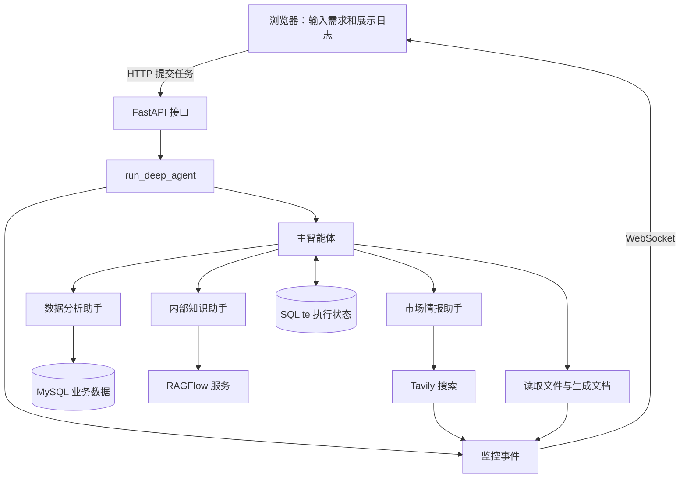

# 00：学习路线与项目地图

[返回课程目录](README.md) · [下一章](01-python.md)

## 1. 学习目标是什么

学完项目，你应该能够独立描述：用户如何提交目标；模型如何选择工具；工具怎样访问外部数据；主智能体怎样委派子智能体；进度怎样回到浏览器；下一轮如何接续状态；发生失败时如何定位。

不要求你先训练神经网络、实现向量数据库或掌握所有前端技术。这个项目主要训练“把模型能力组织成软件”的能力。

把“Agent 开发”分为三个层次，会更容易安排学习：

| 层次 | 典型问题 | 本项目覆盖 |
|---|---|---|
| 模型使用 | 如何发送消息、提供工具描述、理解返回值？ | 模型客户端与工具配置 |
| 任务组织 | 先做什么，何时委派，怎样保留结果？ | 主智能体、子智能体、checkpoint |
| 应用工程 | 多用户、接口、进度、文件、错误怎样处理？ | FastAPI、WebSocket、ContextVar、工具模块 |

## 2. 四种系统有什么区别

普通函数适合步骤和输入输出已经明确的任务。例如把 Markdown 转成 PDF，通常没有必要让模型自己重新发明转换过程。

模型调用适合需要理解、生成或分类的任务。例如把一段用户需求改写为搜索词。

工作流由程序明确安排步骤：先搜索，再提取，再写报告。模型可以在步骤内工作，但主要路径由代码决定。

Agent 把部分行动选择交给模型：先查数据库还是先搜索、信息是否足够、是否需要继续查询。实际系统可以把固定工作流和 Agent 组合使用。

多智能体进一步把不同子任务交给不同配置的 Agent。本项目采用“主智能体统一委派”的结构；没有显式实现助手之间自由协商的网络。

## 3. 系统地图

图中的线表示主要关联，不表示每次任务都会经过所有节点。模型还可能使用框架提供的能力；源码显式配置的工具列表不等于所有版本运行时的完整工具清单。

## 4. 文件夹为什么这样分

| 路径 | 主要责任 | 初学者应关注 |
|---|---|---|
| [agent](../../agent/main_agent.py) | 组装与执行智能体 | 模型、提示词、工具如何组合 |
| [tools](../../tools/tavily_tool.py) | 实际访问数据或执行文件操作 | 输入参数、返回结果、异常 |
| [api](../../api/server.py) | 接收请求、维护连接 | HTTP 与 WebSocket 的分工 |
| [prompt](../../prompt/prompts.yml) | 配置角色和行为 | 路由规则与输出要求 |
| [utils](../../utils/retry.py) | 公共辅助逻辑 | 重试、路径、转换 |
| [rawflow](../../rawflow/rag_config.py) | RAGFlow 配置与演示 | 目录实际拼写是 rawflow |
| [sql](../../sql/init.sql) | 示例数据库初始化 | 表字段和样例数据口径 |
| `data` | 运行时状态数据库 | 与业务数据区分 |
| `updated` | 上传文件 | 实际目录名是 updated |
| `output` | 会话输出和复制后的上传文件 | 与会话编号关联 |

## 5. 推荐安排：十四次学习，每次一个成果

| 次数 | 内容 | 当次交付 |
|---|---|---|
| 1 | 项目地图、基础语法 | 手画一次请求路径 |
| 2 | 函数、字典、装饰器 | 写一个普通计算函数 |
| 3 | 消息与工具调用 | 跑实验 01，标注各消息 |
| 4 | 提示词与上下文 | 修改一条规则并预测影响 |
| 5 | 工具设计 | 写出输入、输出、错误约定 |
| 6 | 多智能体 | 为三个角色划清任务边界 |
| 7 | 执行源码 | 给 run_deep_agent 分阶段 |
| 8 | 前后端 | 在浏览器定位 HTTP 和 WS |
| 9 | 异步与隔离 | 跑实验 02，解释串台 |
| 10 | 状态与文件 | 跑实验 03，区分存储层 |
| 11 | 搜索、SQL、RAG | 跑实验 04，验证金额 |
| 12 | 启动与调试 | 写一份故障定位记录 |
| 13 | 可靠性与评估 | 设计十条固定测试问题 |
| 14 | 综合作业 | 完成一个带工具的新能力 |

时间按自己的节奏安排。某次需要两天也正常。能准确复述并验证，比连续读完很多页面更重要。

## 6. 当前能力边界

系统实现了模型接入、角色配置、搜索/SQL/RAG 工具、文件处理、进度推送和异步 checkpoint 生命周期。

当前没有看到完整的登录鉴权、持久化任务队列、断线事件补发、完整预算管理、自动化质量评估或独立用户长期记忆。SQLite 文件存在也不意味着这些能力自动具备。

当前前端每次“发送新任务”都会生成新 UUID。后端支持传入旧 thread_id，是继续对话的基础；页面默认操作本身并没有提供同一会话内的多轮追问输入流程。

## 7. 自测

1. 用户要求一个确定的文件转换，必须使用多智能体吗？
2. `data/checkpoints.db` 和 MySQL 中的订单分别保存什么？
3. 项目中“上下文”可能指哪些不同内容？

完成后再查 [参考答案](15-answers.md)。
