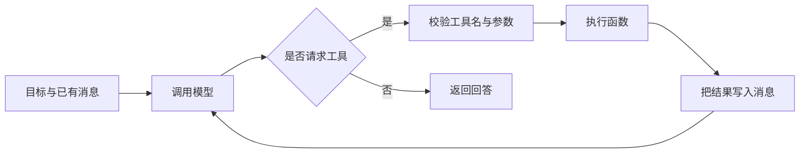

# 02：模型、消息、工具调用与 Agent 循环

[上一章](01-python.md) · [目录](README.md) · [下一章](03-prompts-context.md)

## 1. 模型调用提供什么能力

聊天模型接收输入消息并生成输出。输出可以是回答文字，也可以包含工具调用请求。在 Agent 应用里，“请调用哪个工具、参数是什么”同样是模型输出的一部分。

模型本身并不因看见一个 Python 函数名就获得操作电脑的权限。宿主程序必须注册工具、收到调用请求、执行函数、回传结果。这层执行机制把生成文字与真实行动连接起来。

本项目 [agent/llm.py](../../agent/llm.py) 使用 `init_chat_model` 创建客户端。模型名称读取 `LLM_QWEN_MAX`，接口适配器使用 `openai`。这个环境变量名是作者自定义的，不限制实际模型只能是 Qwen。

`.env.example` 同时列出了多个模型变量，但当前这段初始化代码只读取 `LLM_QWEN_MAX`。改一个未被读取的变量不会自动切换模型。

## 2. 模型参数、提示词、状态各管什么

| 对象       | 内容                 | 修改它会发生什么                   |
| ---------- | -------------------- | ---------------------------------- |
| 模型权重   | 训练得到的内部参数   | 需要训练或更换模型，项目未实现训练 |
| 系统提示词 | 角色、工作方式、规则 | 改变本次应用对模型的指导           |
| 用户消息   | 当前需求             | 改变任务目标                       |
| 工具结果   | 搜索或查询得到的数据 | 增加本次推断可使用的证据           |
| checkpoint | 已保存的执行状态     | 为后续运行恢复相关状态提供基础     |

“把资料给模型看”通常改变上下文，不等于重新训练模型。模型回答有事实错误，也不能只通过调高或调低某个采样参数保证解决。

## 3. Token 与上下文窗口

Token 是模型处理文本等输入时使用的计量单位。它不严格等于一个字或一个英文单词。输入越长、工具输出越大，通常消耗越多上下文与推理资源。

上下文窗口限制单次调用能够处理的内容量。整个项目磁盘里有一百份文档，不代表模型自动读过它们。只有被选择、提取并放入本次上下文的信息才可能直接参与这次推断。

一个常见浪费是：每轮把全部网页原文、全部数据库记录和全部历史重复塞进去。更合理的策略是保留来源、提取相关片段、限制查询结果，必要时分阶段汇总。

具体 token 上限、计费和工具协议因模型与服务而异，本教材不提供固定价格或通用额度。

## 4. 四类常见消息

| 角色      | 用途               | 示例                         |
| --------- | ------------------ | ---------------------------- |
| system    | 应用提供的工作说明 | 你负责协调检索并汇总结果     |
| user      | 用户需求           | 查询某品类趋势               |
| assistant | 模型输出           | 最终回答，或工具调用请求     |
| tool      | 程序执行结果       | 搜索命中、SQL 结果、文件路径 |

具体 API 字段会有差异；下文使用便于理解的简化结构。

工具请求通常带唯一调用 ID，用来把工具结果与对应请求关联。不要把它和整个会话的 thread_id 混淆：一个会话中可以有很多工具调用，每次调用有自己的标识。

## 5. 用一段消息序列看清调用

用户问“100 增长到 120，增长率是多少？”

```json
{"role":"user","content":"100 增长到 120，增长率是多少？"}
```

模型提出调用：

```json
{
  "role":"assistant",
  "tool_calls":[{
    "id":"call_001",
    "name":"calculate_growth",
    "args":{"current":120,"previous":100}
  }]
}
```

程序执行函数，回传：

```json
{"role":"tool","tool_call_id":"call_001","content":"20.00%"}
```

模型再次接收消息序列，给出文字解释。第一次模型调用负责选择行动，第二次模型调用利用结果形成回答。真实任务可能需要更多轮。

这些 JSON 是教学表达，不是承诺某服务的完整原始请求格式。

## 6. 控制循环



真实系统还需要处理超时、取消、错误和步数限制。一个没有退出条件的循环可能不断消耗资源。框架可能提供自己的运行限制，但业务仍应设置适合场景的预算。

“模型说信息足够”是一个判断，不自动证明信息正确。需要引用检查、计算核对、结果评估等外部证据。

## 7. 框架封装与自己实现的关系

LangChain 提供模型、消息、工具等抽象；LangGraph 关注图执行与状态；Deep Agents 在这些基础上提供更高层的智能体组织能力。当前官方概览说明了其规划和子智能体等定位：[Deep Agents 概览](https://docs.langchain.com/oss/python/deepagents/overview)。实际可用接口要匹配项目锁定版本。

项目用 `create_deep_agent` 配置系统，因此调用循环大部分位于框架内部。读项目先关注传入了什么，再针对不明白的行为查看安装版本源码。

框架内部工具与项目 `tools/` 中写真实磁盘文件的工具应分开理解。不要看到“文件系统能力”就假定任意框架虚拟文件路径都对应本机同名路径。

## 8. 离线实验

运行 [01_agent_loop.py](examples/01_agent_loop.py)。它用规则决策器模拟“先查数，再计算，最后回答”，打印每轮消息。

观察：搜索/查询返回的数据会影响后面的计算参数；循环处理的是结构化调用；程序在工具名不合法时拒绝执行。模拟器没有自然语言理解能力，意义是把框架隐藏的执行步骤展示出来。

## 9. 自测

1. 工具调用请求是行动本身，还是行动的描述？
2. 为什么工具返回后通常还要调用模型？
3. 一个 Agent 是否可能产生十次模型调用？
4. 工具返回了“找不到资料”，模型应怎样回答？
