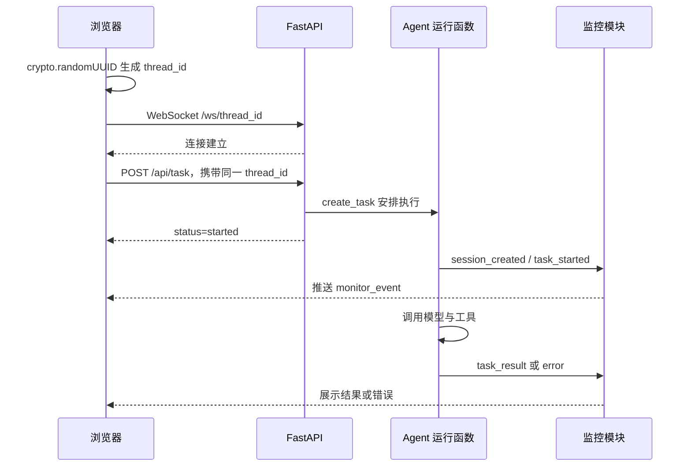

# 07：前后端与一次完整请求

[上一章](06-agent-runtime.md) · [目录](README.md) · [下一章](08-async-context.md)

源码：[api/server.py](../../api/server.py)、[api/static/index.html](../../api/static/index.html)、[api/monitor.py](../../api/monitor.py)。

## 1. 浏览器与后端分别做什么

浏览器负责收集问题、建立消息连接、展示任务日志和文件列表。后端负责创建任务、运行 Agent、调用工具和提供文件。

HTML 描述界面结构，CSS 决定外观，JavaScript 响应按钮与网络消息。这里使用一个页面里的原生 JavaScript，没有必要先学习大型前端框架才能理解业务流程。

## 2. 接口地图

| 方法与地址 | 用途 | 返回/行为 |
|---|---|---|
| `GET /` | 首页 | 读取 index.html |
| `POST /api/task` | 启动任务 | started 与 thread_id |
| `POST /api/upload` | 上传文件 | 保存到 updated 对应目录 |
| `GET /api/files` | 列出文件 | 默认列出整个 output 下文件 |
| `GET /api/download?path=...` | 下载文件 | FileResponse |
| `WS /ws/{thread_id}` | 接收实时事件 | 按会话编号定向推送 |
| `/output/...` | 静态文件访问 | 输出目录挂载 |

上传接口存在，不代表当前页面已经完整实现上传交互。应分别检查后端路由和页面调用。

## 3. 当前实际请求顺序



实际调度中，后台事件与 HTTP 响应的先后可能交错；这张图表示主要逻辑关系。

前端先连接消息通道，减少任务很快失败而浏览器尚未连接时丢失首条事件的问题。当前没有持久化事件重放，因此断线期间的事件仍可能丢失。

## 4. sendTask 精读

它先读取输入并去掉两端空白；禁用发送按钮；生成新的 UUID；调用 createSession；等待 waitForSocket；再用 fetch 提交 JSON。

它还检查 HTTP 是否成功，以及返回的 status 和 thread_id 是否符合预期。finally 恢复按钮、清空输入并聚焦。

每次调用都生成新 UUID。因此切换到旧标签再点“发送新任务”，仍然是新会话，不是自动沿用旧 thread_id 追问。

## 5. waitForSocket 与 Promise

JavaScript Promise 表示未来才确定的结果。waitForSocket 等待 open，遇到 error、close 或十秒超时就拒绝。完成后清理计时器和监听器。

十秒是等待浏览器消息通道的时间，不是模型生成任务的超时。模型任务目前没有同样的整体十秒限制。

## 6. run_task 的立即响应

后端收到 TaskRequest，使用请求里的 ID 或生成 ID，然后 `asyncio.create_task` 安排执行。

started 表示安排了运行，不代表模型已经响应、工具已成功或任务已持久化排队。这个后台任务仍在当前服务进程内，进程退出不会自动由外部队列接管。

## 7. 事件数据怎样进入页面

监控事件大致是：

```json
{
  "type":"monitor_event",
  "event":"tool_start",
  "message":"开始执行工具: 网络搜索工具",
  "data":{"tool_name":"网络搜索工具","args":{"query":"示例"}},
  "timestamp":"2026-11-02T12:00:00"
}
```

这是示例数据。当前时间戳由服务器本地 datetime 产生，没有显式时区偏移。跨时区部署时应统一使用带时区时间。

`ws.onmessage` 解析 JSON，写入 session.logs。task_result 把状态设成 done，error 设成 error，再重新绘制日志和标签。

`renderLog` 当前只展示 result 前 800 个字符。页面显示“内容被截断”，可能是展示层截断，不能直接断言模型只生成了 800 字。

## 8. ConnectionManager 的真实结构

active_connections 保存 `thread_id → 一个 WebSocket`。因此同一 ID 的新连接可能覆盖旧连接。disconnect 又只按 ID 删除，旧连接断开时可能影响该 ID 后来的映射。

这是单连接简化设计，并没有实现“同一会话多个浏览器同时订阅”的连接集合。

服务端收到客户端文本会回复 pong，但当前页面没有看到周期性发送 ping 的计时器。代码支持响应消息，不等于完整心跳方案已建立。

## 9. 关闭标签意味着什么

closeSession 关闭浏览器连接并删除页面内存中的会话信息。没有调用后端取消接口，也没有删除 checkpoint 或文件。

所以关闭标签之后，后台工具可能还在执行。若要“停止任务”，需要后端保存运行任务句柄、处理取消、清理资源，并给前端返回明确终态。

刷新页面同样不会自动恢复 sessions 对象，当前没有 localStorage 或后端会话列表恢复逻辑。

## 10. 浏览器调试练习

打开开发者工具的 Network 面板，提交一个测试问题：找到 `/api/task` 的 Request Payload；检查 ID 是否与 WS 地址一致；查看 WS 消息帧；定位最后一个事件。

若没有结果，按顺序判断：HTTP 是否提交成功；WS 是否建立；是否收到 task_started；是否收到工具事件；是否有 error；是否有 task_result 但页面未展示。

## 11. 自测

1. 为什么先连 WebSocket？
2. 关闭标签是否取消任务？
3. 页面刷新后日志消失，是否表示 SQLite 也清空了？
4. 当前页面能否只凭点击旧标签实现多轮追问？
